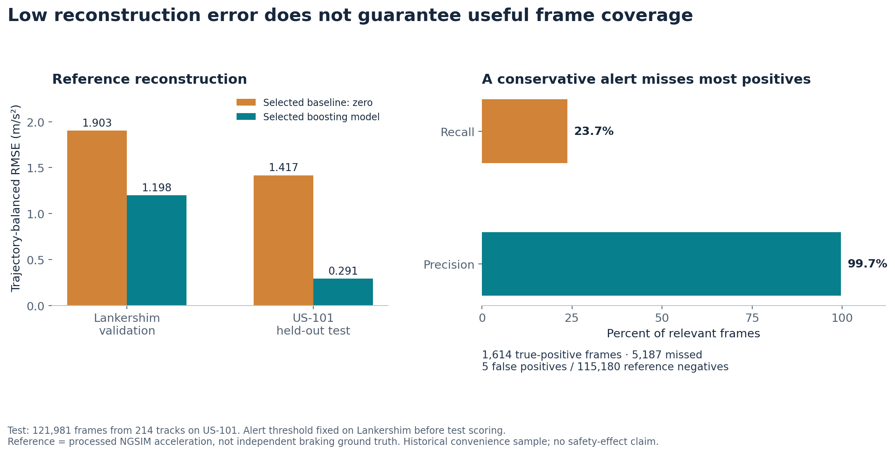
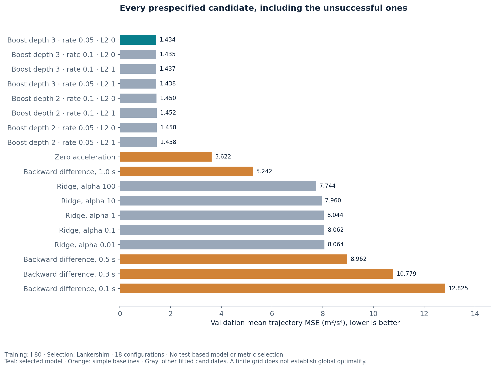
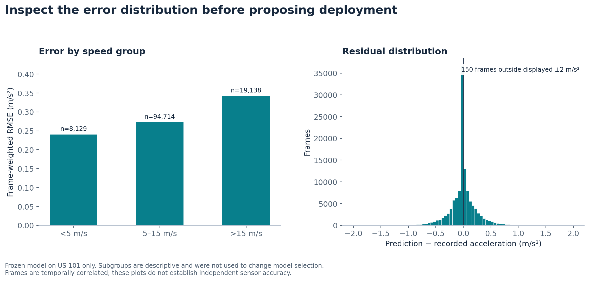

# Deceleration estimation across road environments

Can a speed-based model reconstruct acceleration on a different road while retaining enough braking coverage to be useful? This reproducible study uses 246,144 historical public NGSIM trajectory records, SQL feature lineage and a separated train/validation/test design.

**Finding:** the selected model's held-out-road trajectory-balanced RMSE was **0.291 m/s²**, versus **1.417 m/s²** for the validation-selected zero-acceleration baseline. But the frozen low-false-alert threshold detected only **23.7% of reference-positive frames**. Better reconstruction error is insufficient evidence for a useful safety detector. The next step is independent sensor labels and event-level evaluation on new routes, not deployment.



## What was measured

The reference is processed NGSIM acceleration, not independent brake actuation or collision risk. Speed and acceleration share upstream processing. Past-only feature construction therefore does **not** establish that the source signals could be produced causally in real time.

| Role | Road | Raw rows | Usable frames | Tracks |
|---|---|---:|---:|---:|
| Fit | I-80 | 81,147 | 80,237 | 91 |
| Select model and threshold | Lankershim | 40,876 | 40,156 | 72 |
| Final evaluation | US-101 | 124,121 | 121,981 | 214 |

Vehicle IDs 1–80 define a fixed convenience cohort at each site; IDs are segmented at discontinuities and namespaced by site. The public extraction includes speed, acceleration, frame/time, vehicle class and local longitudinal position. It excludes video, faces, plates and global coordinates. Measurements date from 2005–2006.

## Optimization evidence

The [protocol](PROTOCOL.md) fixed the road split, target, features, objective and search before fitting. Eighteen candidates were compared: five simple baselines, five ridge penalties and eight histogram-boosting configurations. The primary objective was mean per-track MSE, giving each trajectory equal evaluation weight. Training weights also equalized total weight per track. Scaling was fitted only on I-80.

The validation winner was gradient boosting with depth 3, learning rate 0.05, L2 0, 100 iterations and minimum leaf size 30; early stopping was disabled and seed was 20261028. This is the best configuration in the declared finite grid, not a global optimum. The best simple baseline on validation was zero acceleration. [All candidates, timings and scores](results/validation_scores.csv), [frozen configuration](results/selection.json) and compressed observation-level predictions are retained.



The alert threshold was selected on validation to maximize frame recall subject to at most 1% frame false-positive rate. The reference cutoff was −2.4384 m/s² (an analytical definition, not a regulatory threshold); the selected prediction cutoff was −3.2004 m/s². Neither cutoff was changed after test inspection.

## Held-out US-101 results

| Metric | Selected model | Zero baseline |
|---|---:|---:|
| Mean per-track MSE, m²/s⁴ | 0.0846 | 2.0068 |
| Trajectory-balanced RMSE, m/s² | 0.2908 | 1.4166 |
| Trajectory-balanced MAE, m/s² | 0.1678 | 0.9114 |
| Frame RMSE, m/s² | 0.2824 | 1.3923 |
| Reference-positive frame recall | 23.73% | 0% |
| Frame precision | 99.69% | Undefined: no alerts |
| Frame false-positive rate | 0.0043% | 0% |

The model produced 1,614 true-positive, 5 false-positive, 5,187 false-negative and 115,175 true-negative frames. Reference-positive prevalence was 5.58%. These are **frame counts**, not distinct braking events. The paired mean per-track MSE difference was −1.9222 m²/s⁴; a 2,000-draw trajectory bootstrap interval was [−1.9866, −1.8624]. Shared traffic conditions and one test road limit that interval; it is not road-population uncertainty.



## Verification and reproduction

```sh
python -m pip install -r requirements.txt
python -m unittest discover -s tests -v
python src/verify.py test
python src/check_reproduction.py
```

The independent verifier uses exported predictions and source records to recompute metrics, confusion counts, model/threshold selection and the bootstrap interval without calling the fitting code's metric helpers. It also reconciles six source-page hashes and counts, every feature's timestamps/units and disjoint road/track identities. Five regression checks cover source mutation, conflicting timestamps, history resets, future-input independence and constant-speed variance. The offline replay refits from cached data in a disposable folder and compares the published selection and test results.

A cancellation error in rolling variance was caught by independent recomputation **before test scoring**. Centered-window variance replaced the unstable calculation; the failed receipt and superseded validation artifacts remain in [corrections](results/corrections). The frozen selection was committed before the final-test command. Reproduction is a check of the same experiment, not a new untouched test.

## Scope and reuse

This is independent, AI-assisted research, not a production deployment, peer-reviewed publication or claim of a new algorithm. Historical processed trajectories, a small convenience cohort, one validation road and one test road limit transfer claims. No fine-tuning of a pretrained model was performed. Related work already documents substantial NGSIM measurement and reconstruction problems: [Montanino and Punzo (2013)](https://journals.sagepub.com/doi/10.3141/2390-11) and [Coifman and Li (2017)](https://ceg.osu.edu/sites/default/files/2022-06/Coifman_and_Li_2017.pdf).

[FHWA/DOT source and reuse details](SOURCES.md) include the source's CC BY-SA 3.0 license and exact queries. Dataset attribution is retained; no broader rights are asserted. Manuscript drafts remain private and outside Git history. See the [model validation standard](MODEL_VALIDATION_STANDARD.md) for future tuning and release requirements.
